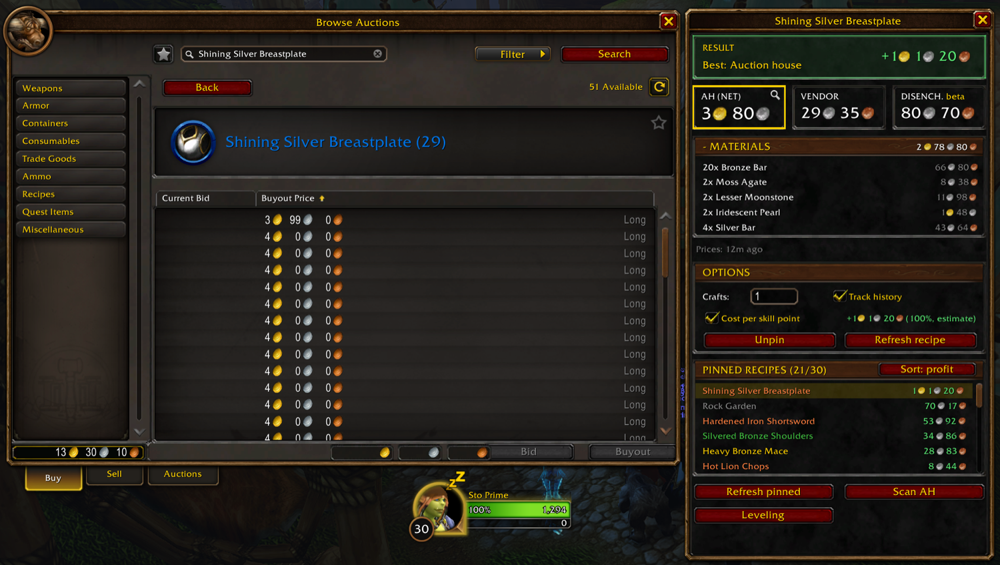
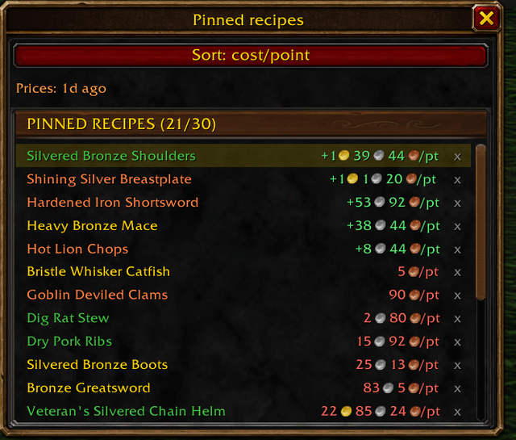
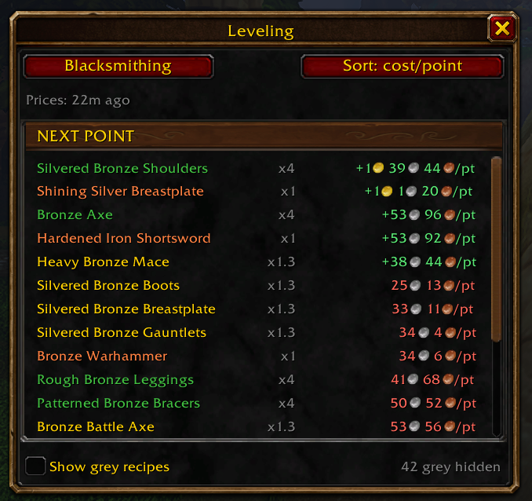
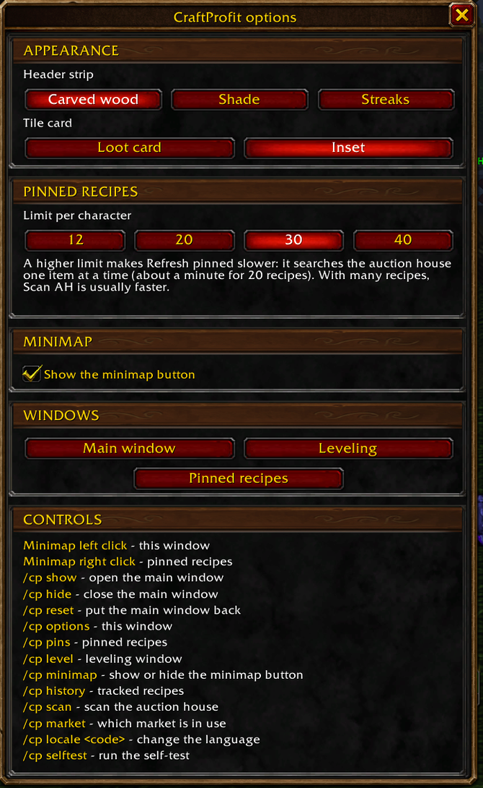

# CraftProfit

**See what a profession recipe really costs at the auction house, and whether to sell, vendor or disenchant the result.**

CraftProfit is an addon for **World of Warcraft: Forever**. Select a recipe you know and a small window next to your profession window adds up the reagents at auction house prices, then compares the three ways to get rid of the crafted item: auction house (net of the commission), vendor, and disenchant. It names the best one, so you can level a profession at the smallest loss, or look for a profit.

*[Lisez-moi en français](README.fr.md)*

> **Status: 1.0.0, for the WoW: Forever beta** (build 1.60.1, Interface 16001), where it was built and tested. Disenchant data still comes from the Classic tables and is marked *beta* in the window. See [Known limitations](docs/user-guide.md#known-limitations).

## Screenshots

## Features

- **Recipe cost** from live auction house prices, with the reagent detail unfolded under the total.
- **Three exits compared**: auction house (after the 5 % commission), vendor price, and the expected disenchant value.
- **Best option highlighted**, with the net result of the craft.
- **Profit in the profession window**: each learned recipe with prices shows what one craft earns or loses at the right of its row in the recipe list (`+12` silver `23` copper coin icons green, `-2` silver red); it can be turned off in the options window.
- **Cost per skill point** (optional): what each point of skill really costs, from the colour of the recipe, shown as a gain when the crafts pay for themselves.
- **Leveling window**: every recipe you know in a profession, ranked by the cost of a skill point, to see what to craft next.
- **Several crafts at once**: multiply a recipe by 1 to 9999 crafts.
- **Pinned recipes** (20 per character by default; 12, 20, 30 or 40 in the options window), sorted by profit or by cost per point, to compare what to craft next (with many pinned, **Scan AH** is usually faster than **Refresh pinned**); under the main window at the auction house, and anywhere in their own window (`/cp pins` or a right click on the minimap button).
- **Auction house tools**: **Refresh recipe** prices the recipe on screen in a few seconds, **Refresh pinned** prices every pinned recipe, **Scan AH** reads the whole auction house; a missed price is asked a second time automatically. Click a reagent to search it in the auction house, quantity already filled in, or the crafted item to see how many are for sale. CraftProfit never buys anything for you.
- **Price history**: tick *Track history* on up to 30 recipes and CraftProfit keeps their prices scan after scan (every point for 7 days, one a day for 60 days); the **History** window charts them over 7, 30 or 60 days (materials cost, sale price or profit: a bar per day, the usual price, a typical week, and a plain sentence saying whether today is cheaper or dearer than usual), and its list says in green or red whether the newest materials cost and sale value are better or worse than usual; the same percentages show in the main window, beside the Materials total and on the AH (NET) tile, with a tooltip of the figures behind them. Prices are kept per ruleset (the game "realm" in the beta) and faction.
- **Standalone**: no Auctionator, no other addon required. It also picks up the scans other addons start.
- **Options window and minimap button**: pick the look of the windows (header strip and tile card), applied at once, and the pinned recipes limit; open it from the minimap button, the addon compartment or `/cp options`.
- **English, French and Spanish** (follows the game language; saved recipe and profession names follow it too).

## Install

1. Download the latest release from [GitHub Releases](https://github.com/Renaud-Sto/CraftProfit/releases) (the CurseForge page will be linked here once it is online), or clone this repository.
2. Copy the `CraftProfit` folder (the one that contains `CraftProfit.toc`) into  
   `World of Warcraft/_classic_beta_/Interface/AddOns/`  
   so that you end up with `.../AddOns/CraftProfit/CraftProfit.toc`.
3. Start the game and check that **CraftProfit** is enabled in the AddOns list. Type `/cp selftest`: it should answer *Self-test passed*.

Developers can symlink the folder instead of copying it, see [CONTRIBUTING.md](CONTRIBUTING.md).

## Quick start

1. Open a profession window and select a recipe you know. The CraftProfit window appears on its right.
2. Go to the auction house, press **Refresh recipe** in the main window (the recipe on screen, a few seconds), **Refresh pinned** (the pinned recipes, about a minute for 20) or **Scan AH** (everything, once per 15 minutes).
3. Pin the recipes you are interested in with the **Pin** button, then compare them from the pinned list.

The full walkthrough, every option and the explanation of each number are in the [User guide](docs/user-guide.md).

## Commands

| Command | Effect |
| --- | --- |
| `/cp` or `/craftprofit` | Show the command list |
| `/cp show` / `hide` | Show or hide the main window |
| `/cp reset` | Put the main window back next to the profession or auction house window |
| `/cp options` | Open or close the options window (look of the windows, pinned recipes limit, minimap button, controls) |
| `/cp minimap` | Hide the minimap button, or show it again |
| `/cp scan` | Start a full auction house scan (auction house open) |
| `/cp history` | Open the History window (`/cp history <n>`: on the n-th tracked recipe); `/cp history list` lists the tracked recipes, `/cp history remove <n>` deletes one |
| `/cp pins` | Open or close the pinned recipes window (works anywhere, last known prices) |
| `/cp level` | Open or close the leveling window |
| `/cp market` | Show which market (ruleset and faction) the prices are saved under |
| `/cp locale <code>` | Force a language (`enUS`, `frFR`, `esES`, `esMX`); without code, back to the game language |
| `/cp selftest` | Run the built-in self-test |

## Documentation

| Document | For whom | Content |
| --- | --- | --- |
| [User guide](docs/user-guide.md) ([FR](docs/user-guide.fr.md)) | Players | Every feature, how each number is computed, options, FAQ, troubleshooting |
| [Technical documentation](docs/technical.md) | Developers | Architecture, data flow, price model, saved variables, game API used, measured behaviour of the beta |
| [Contributing](CONTRIBUTING.md) | Contributors | Setup, tests, probe addon, pull request workflow, adding a language |
| [Changelog](CHANGELOG.md) | Everyone | What changed in each version |
| [In-game checklist](docs/in-game-checklist.md) | Testers | What to verify in the client before a release |
| [Probe findings](docs/probe-findings.md) | Developers | What the in-game probe measured |
| [CurseForge material](docs/curseforge/) | Maintainers | Project page text and submission checklist |
| [Design history](docs/superpowers/) | Developers | The design specs and implementation plans |

## Alternatives

CraftProfit is deliberately small: it answers "what does this recipe cost, and what do I do with the result?". For a broader profession dashboard with leveling guides, crafting queues and shopping lists, look at Forever Profession Master on CurseForge. The two do not conflict.

## Contributing

Bug reports, translation fixes and pull requests are welcome. Read [CONTRIBUTING.md](CONTRIBUTING.md) first, and use the issue templates. Security issues: see [SECURITY.md](SECURITY.md).

## License

[MIT](LICENSE). The disenchant data is derived from a CC BY-SA 4.0 source, see [Credits and data sources](#credits-and-data-sources).

## Credits and data sources

- Disenchant result tables are derived from the Classic tables of [Warcraft Wiki](https://warcraft.wiki.gg/wiki/Disenchanting_tables) (text and data licensed CC BY-SA 4.0) and are being replaced by measurements from Forever.
- Item and recipe data, names and icons belong to Blizzard Entertainment and come from the game at run time; none is stored in this repository.

## Disclaimer

CraftProfit is a fan-made addon. It is not affiliated with or endorsed by Blizzard Entertainment. World of Warcraft is a trademark of Blizzard Entertainment, Inc.
